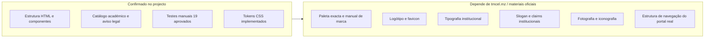

# Fase 6 — Análise da identidade visual e preparação do redesign TMCEL

**Projecto:** Redesign académico — TMCEL, Moçambique Telecom, S.A.  
**Princípio orientador:** *«Mesma identidade. Nova experiência. Melhor tecnologia.»*  
**Data:** 2026-11-17  
**Âmbito:** Análise e proposta documental — **sem alteração** de `index.html`, `css/` ou `js/` nesta fase.

---

## 1. Resumo executivo

O protótipo actual combina **conteúdo institucional genérico**, **catálogo académico funcional** (fases 1–5) e **tokens CSS** inspirados em elementos públicos do portal [tmcel.mz](https://www.tmcel.mz/). A estrutura é single-page, responsiva e acessível. A Fase 6 prepara a evolução visual **sem inventar** paleta oficial, logótipo vectorial, campanhas nem ofertas comerciais. O redesign deve **confirmar** junto do site oficial (quando disponível) e de materiais autorizados o que hoje está apenas **referenciado** ou **observado**.

---

## 2. Análise da estrutura actual (código)

### 2.1 `index.html` (~455 linhas)

| Aspecto | Estado actual |
|---------|---------------|
| Modelo | Single-page com âncoras (`#inicio`, `#servicos`, `#destaques`, `#sobre`, `#contactos`) |
| Semântica | `lang="pt-MZ"`, landmarks (`header`, `main`, `footer`, secções com `aria-labelledby`) |
| Cabeçalho | Wordmark textual «Tmcel» + razão social; nav 5 itens + CTA `tel:100` |
| Hero | Título H1, lead, 2 CTAs, painel «Acesso rápido» (3 links) |
| Serviços | 4 cartões estáticos + bloco `#catalogo-servicos` (banner académico, toolbar, lista, formulário, dialog) |
| Destaques | 3 cartões editoriais (`news-card`) |
| Sobre | Texto institucional + aside «projeto académico» |
| Contactos | Morada/teléfones de referência + formulário demo |
| Rodapé | Wordmark, slogan, copyright académico |
| Imagens | **Nenhuma** `` no markup (logo não integrado) |

### 2.2 `css/style.css` (~1018 linhas)

| Camada | Conteúdo |
|--------|----------|
| Tokens (`:root`) | Cores TMCEL, neutros, espaçamento, raios, sombras, `focus-ring` |
| Base | Reset suave, tipografia sistema, skip-link, `prefers-reduced-motion` |
| Layout | `.container` (max 72rem) |
| Componentes globais | Header sticky, nav, hero, trust-bar, secções, cards, news, sobre, contactos, footer |
| Componentes catálogo | `.catalogo-*` (reutiliza tokens; não mistura identidade de outras operadoras) |
| Responsivo | Breakpoints ~48rem / ~56rem para menu e grelhas |

**Nota técnica:** O comentário no topo do CSS referencia `assets/images/logo-tmcel.png`, mas esse ficheiro **não existe** no repositório (ver §3).

### 2.3 `js/script.js` (~779 linhas)

| Módulo | Impacto visual/UX |
|--------|-------------------|
| `initMobileNav` | Menu collapsible, `aria-expanded`, Escape |
| `initFooterYear` | Ano dinâmico no rodapé |
| `initNavActiveOnScroll` | Estado activo dos links (bordo amarelo) |
| `initContactFormDemo` | Alert demo (sem alteração de layout) |
| `initCatalog` | Render dinâmico de itens, estados vazio/erro, dialog |

Não há frameworks, animações pesadas nem carregamento de temas alternativos — base sólida para evolução CSS.

---

## 3. Recursos em `assets/`

```
assets/
└── images/
    └── .gitkeep
```

| Recurso | Estado | Implicação para identidade |
|---------|--------|----------------------------|
| Logótipo oficial (PNG/SVG) | **Ausente** | Marca depende de wordmark HTML; futuro redesign deve usar ficheiro **autorizado** |
| Fotografia institucional | Ausente | Hero sem imagem; oportunidade visual sem inventar campanhas |
| Ícones / pictogramas | Ausentes | Cartões só tipográficos |
| Favicon | Ausente | Browser usa default |

---

## 4. Inventário dos elementos visuais implementados

### 4.1 Cores

| Token / uso | Hex (no CSS) | Classificação |
|-------------|--------------|---------------|
| `--color-tmcel-yellow` | `#ffd400` | **Observado** no CSS público da página em [tmcel.mz](https://www.tmcel.mz/) (manutenção, 2026) — confirmar em portal activo |
| `--color-tmcel-green` | `#00693e` | **Observado** (mesma fonte) |
| `--color-tmcel-green-dark` | `#004a2c` | **Derivado no projecto** (variante escura para texto/rodapé) |
| `--color-tmcel-green-muted` | `#0d7a4a` | **Derivado no projecto** (links) |
| `--color-tmcel-yellow-soft` | `#fff4cc` | **Derivado no projecto** (fundos suaves) |
| `--color-tmcel-turquoise` | `#00a9a5` | **Referência secundária** (materiais públicos históricos Mcel) — **validar** com TMCEL |
| Neutros texto/fundo/borda | `#1c2b22`, `#4a5c52`, etc. | **Decisão do projecto** (contraste e legibilidade) |

### 4.2 Tipografia

| Elemento | Implementação | Classificação |
|----------|---------------|---------------|
| Família | `Segoe UI`, system-ui, -apple-system, sans-serif | **Genérica** — não é tipoface institucional confirmada |
| Escala | `clamp()` em títulos; base 1rem / line-height 1.65 | **Confirmado** no código |
| Hierarquia | H1 hero, H2 secções, H3 cartões/catálogo | **Confirmado** |

### 4.3 Cabeçalho e navegação

| Elemento | Descrição | Classificação |
|----------|-----------|---------------|
| Sticky header | Fundo branco, borda inferior amarela 3px | **Implementado** |
| Logo | Texto «Tmcel» + «Moçambique Telecom, S.A.» | **Placeholder tipográfico** — substituir por asset oficial quando disponível |
| Menu | 5 âncoras + scroll-spy | **Implementado** |
| CTA Linha 100 | Bloco verde/amarelo | **Confirmado** (canal público documentado); não inventa promoção |
| Mobile | Hamburger + painel absoluto | **Implementado** |

### 4.4 Banners e barras

| Elemento | Função | Classificação |
|----------|--------|---------------|
| **Hero** | Fundo amarelo, H1, CTAs, painel lateral | **Implementado**; copy usa «Estamos Juntos» — **validar** slogan activo no site oficial |
| **Trust-bar** | Faixa verde com 3 mensagens institucionais genéricas | **Implementado** (tom factual, não comercial) |
| **Banner catálogo** | Aviso «Demonstração académica…» | **Confirmado** (fase 5, testes manuais) |

### 4.5 Cartões e grelhas

| Tipo | Uso visual | Classificação |
|------|------------|---------------|
| `.card` | 4 serviços estáticos; topo amarelo | **Implementado** |
| `.news-card` | 3 destaques editoriais | **Implementado** (conteúdo académico/resumo) |
| `.catalogo-item` | Itens dinâmicos; badge «Exemplo académico» | **Implementado** |
| `.hero__quicklink` | Links em caixa branca no hero | **Implementado** |

### 4.6 Rodapé

| Elemento | Descrição | Classificação |
|----------|-----------|---------------|
| Fundo verde institucional | `--color-tmcel-green` | **Implementado** |
| Wordmark + slogan | Texto «Estamos Juntos» | **Validar** com comunicação oficial |
| Disclaimer académico | Texto legal do projecto | **Confirmado** |

### 4.7 Acessibilidade visual

| Elemento | Estado |
|----------|--------|
| Skip-link | Sim |
| `:focus-visible` / `--focus-ring` | Sim (amarelo + verde) |
| Contraste hero amarelo / texto escuro | Implementado; **medir** AA na Fase 7 |
| `prefers-reduced-motion` | Sim |

---

## 5. Confirmado vs dependente de consulta oficial



| Tema | Confirmado no repositório | Depende de consulta oficial |
|------|---------------------------|-----------------------------|
| Verde/amarelo base | Valores em `style.css` com nota de observação em tmcel.mz | Certificação de cores Pantone/HEX oficiais |
| Logótipo | Wordmark HTML | Ficheiro em `assets/` a partir de fonte autorizada |
| Slogan «Estamos Juntos» | Usado no hero/rodapé | Confirmação no portal e materiais de marca |
| Linha 100, morada Maputo | Publicados no site e na página | Actualização se dados institucionais mudarem |
| Turquesa como acento | Token CSS | Uso actual na identidade TMCEL |
| Cartões de serviços | Categorias genéricas do sector | Nomes/pacotes/preços reais |
| Destaques (4G/5G, etc.) | Texto editorial académico | Notícias oficiais sem replicar campanhas inventadas |

---

## 6. Elementos a melhorar (sem mudar código nesta fase)

| Prioridade | Área | Situação actual | Direcção de melhoria |
|------------|------|-----------------|----------------------|
| **P0** | Marca | Sem logótipo raster/vectorial | Integrar asset oficial; manter `alt` e dimensões |
| **P0** | Design tokens | Mistura «observado» + «derivado» | Separar ficheiro `tokens` documentado; validar HEX com TMCEL |
| **P1** | Tipografia | System stack only | Adicionar fonte institucional **só** se confirmada (webfont com fallback) |
| **P1** | Hierarquia visual | Hero e catálogo competem em `#servicos` | Separar visualmente «institucional» vs «laboratório académico» |
| **P1** | Densidade de conteúdo | Página longa single-page | Sticky subnav ou agrupamento; ancora «Saltar para catálogo» |
| **P2** | Imagens | Zero fotografia | Fotos genéricas **licenciadas** ou ilustrações neutras — não simular campanhas TMCEL |
| **P2** | Favicon / OG meta | Ausentes | Ícone a partir do logótipo oficial |
| **P2** | Contraste | Não auditado formalmente | Teste AA (contactos fundo escuro, amarelo hero) |
| **P3** | CSS | ~1k linhas monolíticas | Secções comentadas ou ficheiros parciais **opcionais** (fase implementação) |
| **P3** | Destaques | Estáticos | Ligar a fonte editorial real (RSS/manual) no futuro, sem inventar datas |

**Riscos a evitar:** cores ou layouts de Vodacom/Movitel; pacotes ou preços fictícios; logótipo redesenhado sem aprovação.

---

## 7. Proposta de estrutura visual — futura homepage

Objectivo: **mesma identidade** (verde/amarelo + marca TMCEL), **nova experiência** (clareza, ritmo, acessibilidade), **mesma tecnologia** (HTML/CSS/JS vanilla).

### 7.1 Wireflow vertical (proposto)

```
┌─────────────────────────────────────────────┐
│ HEADER: [Logo oficial] Nav…  [Linha 100]    │  ← sticky, faixa amarela fina
├─────────────────────────────────────────────┤
│ HERO: slogan + 1 frase + 2 CTA              │  ← fundo amarelo institucional
│       [opcional: imagem institucional]      │
├─────────────────────────────────────────────┤
│ TRUST-STRIP: 3 factos (apoio, rede, historia)│  ← verde, texto claro
├─────────────────────────────────────────────┤
│ SERVIÇOS: 4 pilares (cards)                 │  ← grelha 2×2 / 4 col desktop
│   link «Explorar catálogo académico»        │
├─────────────────────────────────────────────┤
│ CATÁLOGO LAB: [banner académico fixo]       │  ← fundo neutro, borda clara
│   toolbar | lista | form                    │  (funcionalidade existente)
├─────────────────────────────────────────────┤
│ DESTAQUES: feed editorial 3 col            │  ← fundo muted
├─────────────────────────────────────────────┤
│ SOBRE: 2 col + aside projeto académico      │
├─────────────────────────────────────────────┤
│ CONTACTOS: info + form demo                 │  ← verde escuro
├─────────────────────────────────────────────┤
│ FOOTER: logo, slogan, legal                 │
└─────────────────────────────────────────────┘
```

### 7.2 Princípios de composição

1. **Ritmo cromático alternado:** amarelo (hero) → verde (trust) → branco → neutro (catálogo) → muted → branco → verde escuro (contactos).
2. **Uma hierarquia H1** por página; slogans institucionais só após validação oficial.
3. **Catálogo** sempre com banner académico **acima** da toolbar (já conforme fase 5).
4. **Touch targets** ≥44px (botões, CTA 100, itens do menu mobile) — manter na implementação.
5. **Conteúdo modular:** blocos substituíveis sem alterar `js` do catálogo.

### 7.3 Breakpoints (alinhar ao actual)

| Viewport | Comportamento proposto |
|----------|------------------------|
| &lt; 48rem | Menu colapsado; cards 1 col; catálogo toolbar empilhada |
| 48–72rem | Cards 2 col; hero 1 col (painel rápido abaixo) |
| &gt; 72rem | Hero 2 col; cards 4 col; destaques 3 col |

---

## 8. Recomendações para implementação da nova interface (Fase 7+)

### 8.1 Ordem sugerida de trabalho

| Passo | Actividade | Saída |
|-------|------------|-------|
| 1 | Consultar [tmcel.mz](https://www.tmcel.mz/) quando activo; capturar logótipo autorizado | Ficheiros em `assets/images/` + nota de proveniência em `docs/` |
| 2 | Documentar paleta **oficial** vs **derivada** numa tabela em `docs/` | Actualização de `:root` (fase código) |
| 3 | Redesenhar **só** CSS: header/hero/footer primeiro | Diff visual sem mudar HTML |
| 4 | Integrar `` logo + favicon | Ajustes mínimos em HTML |
| 5 | Auditoria contraste (WCAG AA) | Registo em `docs/registo-testes.md` ou anexo |
| 6 | Rever copy institucional com fontes públicas | Sem preços nem campanhas inventadas |
| 7 | Regressão: 19 testes manuais + AUTO parcial | Manter funcionalidades do catálogo |

### 8.2 O que não fazer na implementação

- Não adoptar identidade visual de outras operadoras.
- Não publicar pacotes, preços ou promoções TMCEL sem documentação.
- Não remover o aviso do catálogo académico.
- Não introduzir frameworks ou build obrigatório (conforme planeamento).

### 8.3 Ligação a documentos existentes

| Documento | Relação com Fase 6 |
|-----------|-------------------|
| `docs/planeamento-tecnico.md` | Arquitectura funcional já validada |
| `docs/registo-testes.md` | Baseline UX; repetir após mudanças visuais |
| `docs/roteiro-validacao-manual.md` | Reutilizar após Fase 7 |

---

## 9. Conclusão da Fase 6

A base **funcional e semântica** está madura; a **identidade visual** está **parcialmente alinhada** a indícios públicos da TMCEL, mas **não fechada** sem logótipo, tipografia e paleta certificados pelo portal oficial. A proposta de homepage preserva a estrutura actual e melhora sobretudo **marca, ritmo, contraste e recursos gráficos** — em linha com *«Mesma identidade. Nova experiência. Melhor tecnologia.»*

---

*Ficheiros de código não foram modificados nesta fase. Próximo passo: Fase 7 — implementação visual incremental com validação oficial prévia.*