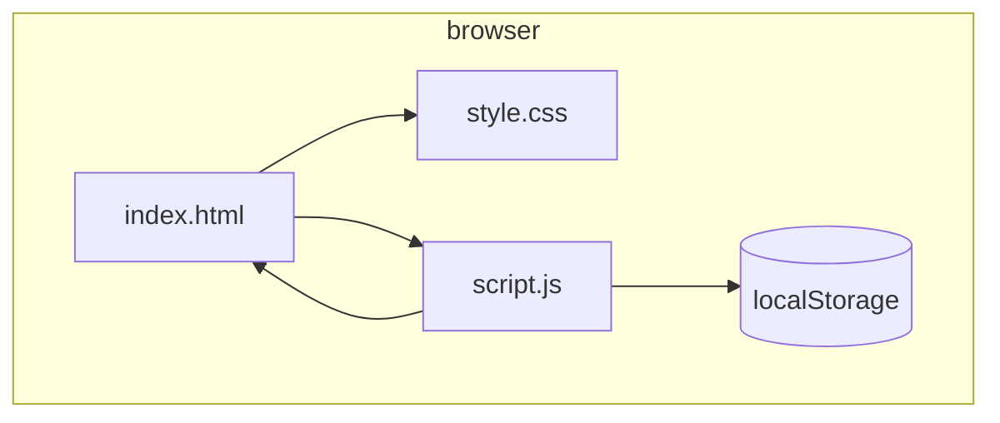
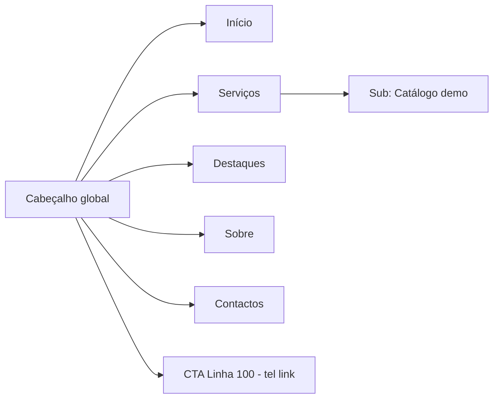

# Planeamento técnico — Redesign TMCEL (fase funcional / UX)

**Projecto:** Redesign académico do website da TMCEL — Moçambique Telecom, S.A.  
**Stack:** HTML5, CSS3, JavaScript (Vanilla), sem frameworks nem dependências npm.  
**Âmbito desta fase:** Arquitectura funcional, experiência do utilizador e contratos de dados — **sem** identidade visual definitiva nem conteúdo comercial fictício da operadora.

---

## 1. Objectivos

### 1.1 Objectivos de produto (académico)

- Oferecer uma **homepage e navegação claras** para um portal institucional e de auto-serviço simplificado.
- Permitir **exploração e gestão local** de um catálogo de serviços/pacotes **inseridos pelo utilizador ou pela equipa** no âmbito do projecto — nunca apresentados como ofertas oficiais TMCEL sem fonte verificável.
- Preparar **persistência no browser** (`localStorage`) para demonstração de fluxos (adicionar, remover, filtrar) sem backend.
- Garantir **acessibilidade** (WCAG 2.2 nível AA como meta) e **responsividade** mobile-first.
- Manter a **árquitectura de ficheiros actual** (`index.html`, `css/style.css`, `js/script.js`, `assets/images/`) até uma fase explícita de modularização.

### 1.2 Objectivos técnicos

- Separar concerns: **estrutura (HTML)**, **apresentação (CSS)** e **comportamento (JS)** com APIs internas documentadas.
- Definir **modelo de dados versionado** e migrações simples no `localStorage`.
- Estabelecer **estratégia de testes funcionais** reproduzível manualmente e, opcionalmente, com checklist automatizável mais tarde (sem frameworks nesta fase).

### 1.3 Restrições de conteúdo

| Permitido | Proibido |
|-----------|----------|
| Categorias genéricas do sector (ex.: «Voz móvel», «Dados», «Fibra», «Empresarial») como **taxonomia de UI** | Pacotes, preços ou promoções atribuídos à TMCEL sem documentação oficial |
| Itens de exemplo marcados como **«Conteúdo académico / demonstração»** | Identidade visual de Vodacom, Movitel ou outras operadoras |
| Dados inseridos pelo utilizador no exercício (nome livre) | Cores ou logótipos oficiais inventados ou impostos nesta fase de design |
| Referência a canais públicos conhecidos (ex.: Linha 100) apenas como **link/info institucional genérica** | Afirmação de parceria ou site oficial |

---

## 2. Análise da estrutura actual

### 2.1 Inventário (estado do repositório)

```
Redesign-TMCEL/
├── index.html          # Entry point; landmarks, skip-link, secções âncora
├── css/style.css       # Tokens, layout, componentes (evolução visual em curso)
├── js/script.js        # IIFE: menu mobile, ano no rodapé, scroll-spy, form demo
├── assets/images/      # Recursos estáticos (vazio excepto .gitkeep)
├── README.md           # Visão geral e instruções de execução
└── docs/               # Documentação de planeamento (esta fase)
```

### 2.2 Capacidades já implementadas (baseline)

- Cabeçalho fixo, navegação por âncora, menu mobile com `aria-expanded`.
- Secções: início, serviços, destaques, sobre, contactos (estrutura única página).
- Comportamentos JS básicos de UX (fecho de menu, scroll-spy, formulário demonstrativo).

### 2.3 Lacunas face à fase funcional

- Sem **módulo de catálogo** nem separação de dados/apresentação.
- Sem **localStorage** nem seed académico versionado.
- Sem **listagem dinâmica** com pesquisa, filtros e ordenação.
- Sem **página ou painel** dedicado à gestão de itens do catálogo (CRUD local).
- `README.md` descreve estado «inicial» — alinhar na fase de documentação, sem reescrever a homepage nesta etapa.

---

## 3. Arquitectura

### 3.1 Padrão geral: «Progressive enhancement»

1. **HTML:** conteúdo e formulários utilizáveis sem JS (listas estáticas ou `<noscript>` com aviso).
2. **CSS:** layout responsivo independente do catálogo dinâmico.
3. **JS:** hidratação da UI, leitura/escrita em `localStorage`, eventos acessíveis.

### 3.2 Camadas lógicas (dentro de `js/script.js` ou ficheiros futuros opcionais)

| Camada | Responsabilidade | Exemplos de funções (nomes planeados) |
|--------|------------------|--------------------------------------|
| **Storage** | Chaves, serialização, versão, quotas, erros | `loadCatalog()`, `saveCatalog()`, `migrateCatalogIfNeeded()` |
| **Domain** | Validação, regras de negócio académicas | `validateCatalogItem()`, `canDeleteItem()` |
| **Catalog service** | CRUD, query, sort, filter | `addItem()`, `removeItem()`, `queryItems({ search, category, sort })` |
| **UI / controllers** | DOM, eventos, render | `renderCatalogList()`, `bindCatalogFilters()` |
| **A11y helpers** | Anúncios live region, foco | `announce()`, `trapFocus()` (só se modal) |

**Decisão de evolução de ficheiros:** manter `script.js` como orquestrador até o catálogo estabilizar; depois, **opcionalmente** extrair para `js/catalog.js` e `js/storage.js` **sem** alterar paths públicos nem exigir bundler.

### 3.3 Diagrama de dependências (alto nível)



### 3.4 Secção futura «Catálogo» na homepage (encaixe DOM)

- Container estável: `#catalogo-servicos` dentro de `#servicos` (ou sub-secção `#catalogo`).
- **Slots:** barra de ferramentas (pesquisa, filtro, ordenação), lista `#catalogo-lista`, formulário `#catalogo-formulario`, região `aria-live="polite"` para feedback.
- Estado vazio explícito: «Nenhum item. Adicione um item de demonstração.»

---

## 4. Mapa de navegação

### 4.1 Modelo: single-page com âncoras (fase 1)

Mantém `index.html` como hub principal; evita proliferar páginas antes de haver conteúdo institucional real.

| ID / âncora | Propósito | Público |
|-------------|-----------|---------|
| `#inicio` | Proposta de valor, acesso rápido | Todos |
| `#servicos` | Visão geral + **catálogo dinâmico (demo)** | Particulares / estudantes |
| `#destaques` | Notícias / iniciativas (estático ou CMS futuro) | Todos |
| `#sobre` | TMCEL + aviso académico | Todos |
| `#contactos` | Informação de contacto + formulário | Todos |

### 4.2 Mapa visual



### 4.3 Navegação intuitiva — princípios

- **Máximo 7±2 itens** no menu principal; secções profundas via subtítulos ou «Saltar para catálogo».
- **Breadcrumb leve** não necessário em SPA de uma página; usar títulos `h1`–`h3` hierárquicos.
- **CTA persistente** de apoio (`tel:100`) — informativo, não comercial inventado.
- **Estado activo** coerente: classe + `aria-current="location"` (já previsto no scroll-spy).

### 4.4 Fase 2 (opcional, não implementar agora)

- `servicos.html` / `pacote-detalhe.html` só se o catálogo exigir URLs partilháveis; até lá, detalhe em `<dialog>` ou painel expansível.

---

## 5. Planeamento da homepage (informação e UX)

| Secção | Conteúdo estático (fase institucional) | Comportamento dinâmico (esta fase) |
|--------|----------------------------------------|-------------------------------------|
| Cabeçalho | Marca textual neutra; menu | Toggle mobile, foco, escape |
| Início | Mensagem institucional genérica | Nenhum |
| Serviços | Texto explicativo + aviso «demo» | **Catálogo local** completo |
| Destaques | Cards estáticos / placeholders editoriais | Opcional: ordenar por data quando itens tiverem `dataPublicacao` |
| Sobre | Texto factual + disclaimer académico | Nenhum |
| Contactos | Morada/tel de referência pública | Validação form; sem envio real |
| Rodapé | Copyright, slogan apenas se validado oficialmente | Ano dinâmico |

**Ordem de leitura (wireflow):** Cabeçalho → Hero → Barra de confiança/informaçã → Serviços (catálogo) → Destaques → Sobre → Contactos → Rodapé.

---

## 6. Catálogo dinâmico de serviços e pacotes

### 6.1 Conceito

O catálogo é um **«ambiente de laboratório»** para o projecto académico:

- O utilizador (ou professor/aluno) **adiciona** registos com nome, categoria e campos opcionais.
- Nenhum item **seed** deve imitar nomenclatura comercial real TMCEL (ex.: evitar nomes de pacotes reais).
- UI deve exibir **rótulo visível:** «Catálogo demonstrativo — não constitui oferta TMCEL».

### 6.2 Categorias (taxonomia fixa da app, não «ofertas»)

| `categoriaId` | Etiqueta UI |
|---------------|-------------|
| `voz` | Voz móvel |
| `dados` | Dados / Internet móvel |
| `fibra` | Internet fixa / fibra |
| `empresarial` | Empresarial |
| `outro` | Outro (especificar em descrição) |

Categorias são **filtros de interface**, não produtos TMCEL.

### 6.3 Funcionalidades

| Função | Descrição | Regras |
|--------|-----------|--------|
| **Adicionar** | Formulário cria item com `id` UUID/`crypto.randomUUID` ou contador + timestamp | Validar nome obrigatório; `preco` ≥ 0 se preenchido; `data` ISO se preenchida |
| **Remover** | Acção por item com confirmação acessível (`confirm` ou `<dialog>`) | Só remove da cópia local; não afecta «oficial» |
| **Pesquisar** | Campo «Pesquisar por nome» (debounce ~200 ms) | Case-insensitive, normalizar acentos opcional |
| **Filtrar** | `<select>` categoria + «Todas» | Combina com pesquisa (AND) |
| **Ordenar** | `<select>`: nome A–Z, nome Z–A, preço asc/desc (ignorar nulos), data asc/desc | Desactivar opções de preço/data se nenhum item tiver o atributo |

### 6.4 Fluxo de renderização

1. Carregar do `localStorage` (ou seed inicial académico vazio).
2. Aplicar query (search + category).
3. Ordenar cópia do array (não mutar fonte).
4. Renderizar lista; actualizar contagem «Mostrando X de Y».
5. Anunciar alterações na `live region`.

---

## 7. Modelo de dados

### 7.1 Entidade `CatalogItem`

```json
{
  "id": "string",
  "nome": "string",
  "categoriaId": "voz | dados | fibra | empresarial | outro",
  "descricao": "string",
  "precoMzn": "number | null",
  "dataReferencia": "string (ISO 8601 date) | null",
  "criadoEm": "string (ISO 8601 datetime)",
  "actualizadoEm": "string (ISO 8601 datetime)",
  "origem": "utilizador | seed-academico",
  "eDemonstracao": true
}
```

### 7.2 Contentor persistido

```json
{
  "schemaVersion": 1,
  "itens": [ "CatalogItem..." ],
  "preferenciasUi": {
    "ultimaCategoriaFiltro": "string | null",
    "ultimaOrdenacao": "nome-asc"
  }
}
```

### 7.3 Chaves `localStorage`

| Chave | Conteúdo |
|-------|----------|
| `tmcel_academico_catalogo_v1` | JSON do contentor acima |
| `tmcel_academico_catalogo_backup` | Último snapshot antes de migração (opcional) |

### 7.4 Migração

- Se `schemaVersion` desconhecido: tentar parse; em falha, repor array vazio e log `console.warn`.
- Incrementar versão só quando campos obrigatórios mudarem.

### 7.5 Seed inicial recomendado

- **Array vazio** por defeito, **ou** no máximo 1–2 itens claramente rotulados:

  - nome: «Exemplo académico — pacote de dados»
  - `eDemonstracao: true`, `origem: "seed-academico"`, sem preço comercial sugestivo.

---

## 8. localStorage — política de utilização

| Aspecto | Decisão |
|---------|---------|
| **Propósito** | Demonstrar CRUD e filtros sem servidor |
| **Limite** | Monitorar tamanho (&lt; 100 itens no exercício); aviso se `QuotaExceededError` |
| **Privacidade** | Sem dados pessoais sensíveis; formulário contacto **não** persistir sem consentimento explícito futuro |
| **Sincronização** | `storage` event entre tabs — recarregar lista se outra tab alterar o catálogo |
| **Reset** | Botão «Repor catálogo» com confirmação — apaga chave ou repõe seed vazio |
| **SSR / file://** | Detectar indisponibilidade de `localStorage` e mostrar banner «Modo só leitura» |

---

## 9. Componentes (UI + JavaScript)

### 9.1 Componentes de interface (HTML)

| Componente | Marcação sugerida | A11y |
|------------|-------------------|------|
| `SiteHeader` | `<header>`, nav, skip-link | `aria-expanded` no menu |
| `Hero` | `<section id="inicio">` | Um único `h1` por página |
| `CatalogToolbar` | `role="search"` no campo nome | Labels visíveis |
| `CatalogList` | `<ul>` / cards `<li>` | Lista nomeada por heading |
| `CatalogItemCard` | botões «Remover» com `aria-label` | Foco visível |
| `CatalogForm` | `fieldset` + `legend` | Erros ligados via `aria-describedby` |
| `EmptyState` | parágrafo + CTA adicionar | Anunciado em live region |
| `SiteFooter` | `<footer>` | — |

### 9.2 Módulos JavaScript necessários

| Módulo | Funções-chave | Prioridade |
|--------|---------------|------------|
| `initApp` | Orquestração no `DOMContentLoaded` | P0 |
| `nav` | Mobile, escape, scroll-spy | P0 (existe) |
| `storage/catalogStore` | load/save/migrate | P0 |
| `catalogService` | CRUD + query | P0 |
| `catalogUI` | render, bind events | P0 |
| `catalogValidators` | regras de campos | P0 |
| `a11y/announcer` | live region | P1 |
| `contactForm` | validação demo | P1 (existe parcial) |
| `footerYear` | utilitário | P2 (existe) |

### 9.3 Contrato de eventos internos (custom events opcionais)

- `catalog:changed` — após add/remove/save; UI subscreve re-render.
- `catalog:error` — validação ou storage falhou.

---

## 10. Acessibilidade e responsividade

### 10.1 Acessibilidade (requisitos)

- **Teclado:** todos os controlos do catálogo operáveis sem rato; ordem de tab lógica (toolbar → lista → form).
- **Focus:** estilos `:focus-visible` (já iniciados no CSS); não suprimir outline.
- **Nomes acessíveis:** botões só com ícone proibidos; usar texto ou `aria-label`.
- **Anúncios:** região `aria-live="polite"` para resultados de pesquisa e confirmação de remoção.
- **Contraste:** quando a identidade visual for aplicada, validar AA; nesta fase usar defaults do sistema sem impor cores institucionais.
- **Formulários:** `label` explícitos, `required`, mensagens de erro associadas.
- **Redução de movimento:** respeitar `prefers-reduced-motion` (já contemplado no CSS actual).

### 10.2 Responsividade (requisitos)

| Breakpoint (referência) | Comportamento |
|-------------------------|---------------|
| &lt; 48rem | Menu colapsável; catálogo em coluna única; toolbar empilhada |
| 48–64rem | Grelha 2 colunas para cards |
| &gt; 64rem | Grelha 3–4 colunas; hero em duas colunas se aplicável |

- **Touch targets** mínimo ~44×44 px em botões de acção.
- **Tipografia fluída** com `clamp()` onde fizer sentido (sem alteração visual definitiva agora).

---

## 11. Estratégia de testes funcionais

### 11.1 Abordagem

Fase actual: **testes manuais estruturados** com checklist; registo em `docs/registo-testes.md` (futuro). Sem Cypress/Jest nesta stack.

### 11.2 Matriz de casos (catálogo)

| ID | Cenário | Passos resumidos | Resultado esperado |
|----|---------|------------------|-------------------|
| CAT-01 | Adicionar item válido | Preencher nome + categoria → Guardar | Item na lista; persistência após F5 |
| CAT-02 | Nome vazio | Submeter sem nome | Erro; foco no campo |
| CAT-03 | Remover item | Remover + confirmar | Item ausente; storage actualizado |
| CAT-04 | Pesquisa | Digitar substring do nome | Lista filtrada; contagem correcta |
| CAT-05 | Filtro categoria | Seleccionar «Dados» | Só itens dessa categoria |
| CAT-06 | Ordenação nome | Z–A | Ordem invertida |
| CAT-07 | Ordenação preço | Itens com e sem preço | Nulos no fim ou regra documentada |
| CAT-08 | localStorage cheio | Simular quota (dev tools) | Mensagem de erro amigável |
| CAT-09 | Sem localStorage | Modo privado restrito | Modo leitura / aviso |
| CAT-10 | Multi-tab | Tab A remove; Tab B activa | Lista sincronizada |

### 11.3 Matriz (navegação e a11y)

| ID | Cenário | Resultado esperado |
|----|---------|-------------------|
| NAV-01 | Skip-link | Foco vai a `#conteudo-principal` |
| NAV-02 | Menu mobile | `aria-expanded` alterna; escape fecha |
| NAV-03 | Só teclado | Percorrer menu e catálogo completo |
| NAV-04 | Zoom 200% | Sem overflow horizontal crítico |

### 11.4 Regressão visual

- Screenshots manuais por breakpoint antes/depois de cada iteración (identidade visual fase posterior).

### 11.5 Critérios de aceitação da fase funcional

- CRUD local funcional com persistência.
- Pesquisa, filtro e ordenação combinam correctamente.
- Aviso «demonstração académica» visível no bloco do catálogo.
- Checklist CAT e NAV sem falhas bloqueantes.
- Nenhum preço ou pacote apresentado como oferta oficial TMCEL.

---

## 12. Riscos e mitigações

| Risco | Mitigação |
|-------|-----------|
| Conteúdo fictício confundido com TMCEL | Banner + `eDemonstracao` + README |
| `file://` e storage | Recomendar Live Server no README |
| `script.js` monolítico crescente | Extrair módulos quando CAT-01..10 estiverem verdes |
| Scope creep de design | Congelar CSS institucional até fase dedicada |

---

## 13. Referências internas

- `README.md` — execução local e aviso académico.
- `index.html` — landmarks e secções existentes (evolução incremental, não substituição abrupta).
- `js/script.js` — ponto de extensão para catálogo.

---

*Documento criado na fase de planeamento funcional. Não substitui briefings de identidade visual nem materiais oficiais TMCEL.*